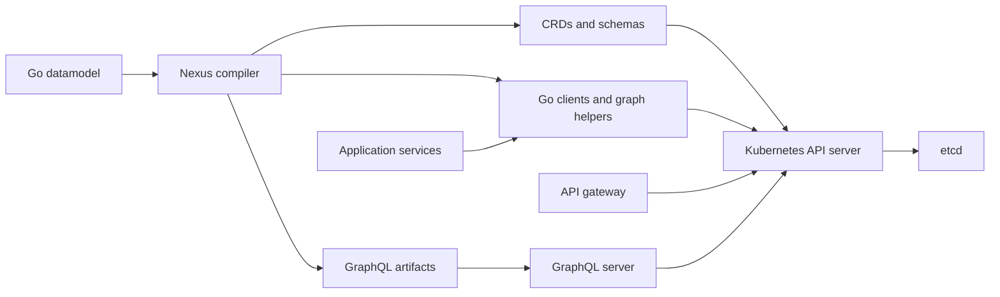

# Graph Framework for Microservices

Nexus is a framework for defining application state as a graph and generating the APIs and Go clients that work with it. It combines a Go-based datamodel language, a compiler, and runtime components built around Kubernetes resource APIs.

Use it when several services need a shared model for configuration or state, including parent–child relationships, references between objects, API access, and change notifications. Applications implement the business logic that responds to that state.

## How it works

1. **Define a datamodel.** Describe entities as Go structs, embed Nexus node types, and annotate relationships and API behavior.
2. **Compile the model.** The compiler produces CustomResourceDefinitions (CRDs), Go resource types and clients, graph helpers, and GraphQL artifacts.
3. **Install the model.** Apply the generated resources to a runtime backed by a Kubernetes API server and etcd.
4. **Build services against the graph.** Use generated clients to manage objects and subscribe to changes. Expose application state through the gateway and configured GraphQL server.



The graph is represented through resources and relationship metadata. Its storage layer uses Kubernetes resources; it does not require a separate graph database.

## Defining a graph

A node embeds `nexus.Node` or `nexus.SingletonNode`. Fields tagged `nexus:"children"` describe collections of children; `nexus:"child"` describes a single child. Links reference other nodes.

This shortened example defines projects with services:

```go
package model

import "github.com/dilipmighty245/graph-framework-for-microservices/nexus/nexus"

type Root struct {
    nexus.SingletonNode
    Projects Project `nexus:"children"`
}

type Project struct {
    nexus.Node
    Services Service `nexus:"children"`
}

type Service struct {
    nexus.Node
    Image    string
    Replicas int
}
```

The compiler requires a rooted ownership hierarchy and validates model relationships. The generated client handles graph operations such as creating children, resolving links, and naming resources within their parent hierarchy.

See the [DSL reference](compiler/DSL.md) for syntax and [compiler examples](compiler/example/datamodel) for larger models and API annotations.

## Components

| Directory | Responsibility |
| --- | --- |
| [compiler](compiler/README.md) | Parses datamodels and generates resource definitions, clients, and API artifacts. |
| [nexus](nexus/README.md) | Defines the node markers and API declaration types used by datamodels. |
| [api](api/README.md) | Defines the runtime's admin datamodel. |
| [api-gw](api-gw/README.md) | Serves and routes APIs, tracks datamodels, and integrates authentication and Envoy configuration. |
| [graphql-server](graphql-server/README.md) | Loads generated GraphQL server plugins for installed datamodels. |
| [validation](validation/README.md) | Validates and mutates Nexus resource requests. |
| [authz-controller](authz-controller/README.md) | Translates Nexus authorization resources into Kubernetes RBAC resources. |
| [connector](connector/README.md) | Replicates configured resources between endpoints. |
| [connector-controller](connector-controller/README.md) | Manages connector instances for endpoint resources. |
| [cli](cli/README.md) | Provides datamodel, application, and runtime workflows. |
| [install-validator](install-validator/README.md) | Checks CRD changes during installation and upgrades. |
| [common-library](common-library/README.md) | Provides shared naming and schema comparison helpers. |
| [nexus-runtime-manifests](nexus-runtime-manifests/README.md) | Packages runtime deployments and local environments. |
| [app-templates](app-templates/README.md), [datamodel-templates](datamodel-templates/README.md) | Provide application and datamodel scaffolding. |
| [calibration](calibration/README.md) | Generates workloads and collects performance data. |

The repository also includes customized copies of `gqlgen`, `kube-openapi`, and `kubebuilder`. They support generation and scaffolding. Their local changes and fixtures are part of the build; replacing them with upstream releases requires compatibility checks.

## Exploring the source

Clone the complete repository so sibling modules referenced by local `replace` directives are available:

```sh
git clone https://github.com/dilipmighty245/graph-framework-for-microservices.git
cd graph-framework-for-microservices
```

Start with the [compiler](compiler/README.md), inspect its [example datamodel](compiler/example/datamodel), and then read the [CLI guide](cli/README.md) and [runtime packaging guide](nexus-runtime-manifests/README.md).

Each component has its own `go.mod`. Run Go commands from the component directory. The root module does not aggregate the repository, so root-level `go test ./...` does not validate the framework.

Go build containers use the [official Docker Hub Go image](https://hub.docker.com/_/golang).
Framework image tags are local by default. Set `DOCKER_REGISTRY` explicitly when
downloading or publishing your own framework images.

For example, to check the shared library:

```sh
cd common-library
go test ./...
```

## Build and runtime prerequisites

Go is required for development. Container workflows also use Docker and Make; deployment workflows use Kubernetes tooling such as `kubectl`, Helm, or Kind. Generation requires additional tools described in the compiler guide.

Toolchain versions currently differ between modules and container builders. Compiler and SDK modules declare Go 1.22, while several build images still use older versions. Go 1.27.2 is a proposed migration target, not a completed repository-wide compatibility guarantee. Select and validate a toolchain for the component you are building.

Generate the admin API before building services that import `api/build`. A fresh checkout does not contain those generated packages. Some installation scripts and image defaults remain tied to specific registries and must be configured for your environment.

## Running checks

From the repository root:

```sh
make test.framework          # Complete source suites across framework modules
make test.framework.gateway  # Gateway and controllers after admin API generation
make test.framework.all      # Source suites, fresh generation, and Kind E2E
make test.framework.builders # Public Go builders, generation, and live subscription tests
make test.framework.stability # Repeat all checks three times
```

For generated-model, resource lifecycle, gateway, and GraphQL checks in a temporary
Kind cluster:

```sh
make test.framework.e2e
```

See the [testing guide](docs/testing.md) for prerequisites, coverage, component
selection, optional compiler images, and logs.

## Development status

Run the source suites and disposable Kind checks before submitting framework changes. Services that import `api/build` need generated admin APIs; the E2E runner generates these in an isolated snapshot. Gateway controller tests use Kubernetes envtest assets or an explicitly configured disposable cluster.

Generated code should be rebuilt from its datamodel and templates. Keep fixtures that tests compare against, and review regeneration diffs before committing them. GraphQL plugins and their host must use compatible toolchains, dependencies, and build settings.

## Examples and reference material

- [DSL syntax and annotations](compiler/DSL.md)
- [Compiler datamodel examples](compiler/example/datamodel)
- [Traffic lights demonstration](demo/traffic-lights/README.md)
- [Edge power scheduler demonstration](demo/edge-power-scheduler/README.md)
- [Existing workflow guides](docs/getting_started)

The workflow guides contain historical deployment examples; check their image names, prerequisites, and commands against the current source before using them.

## License

This project is distributed under the [Apache License 2.0](LICENSE). See [NOTICE](NOTICE) for attribution and [contribution requirements](CONTRIBUTING.md) before contributing.
